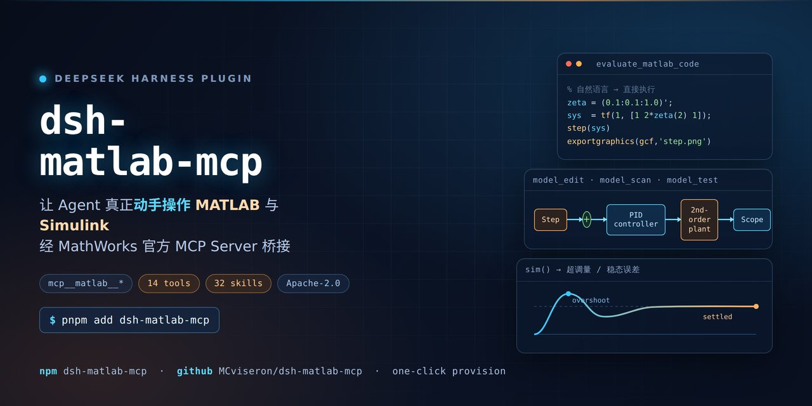

# dsh-matlab-mcp

[中文](README.md) | **English**

[](https://www.npmjs.com/package/dsh-matlab-mcp) [](LICENSE) [](package.json)

A DeepSeek Harness (DSH) plugin that lets the agent **actually drive MATLAB and Simulink**: run MATLAB code, execute `.m` scripts and unit tests, statically check code quality, and read/edit/query/check/simulate Simulink models — all through the **official MathWorks MATLAB MCP Server**, with the **MATLAB / Simulink Agentic Toolkit** skills injected into the session.

> This is not "an AI inside MATLAB". It is the other way round: **MATLAB is exposed as an MCP server that DSH calls**. The plugin only mounts the official server, provisions the official artifacts, and registers the official skills.

```
you ──natural language──▶ DSH agent
                           ├─ tools  mcp__matlab__<tool>  ──stdio MCP──▶ MATLAB MCP Server (official exe) ──▶ MATLAB / Simulink
                           ├─ skills matlab-* / simulink-*  ── from the two official Agentic Toolkits
                           └─ system-prompt guidance (call rules, timeouts, figure export, Simulink tool preference)
```

## Contents

- [Features](#features)
- [Upstream components](#upstream-components)
- [Requirements](#requirements)
- [Install](#install)
- [Artifact sources](#artifact-sources)
- [Configuration](#configuration)
- [Tools and skills](#tools-and-skills)
- [Skills injection](#skills-injection)
- [Usage examples](#usage-examples)
- [Troubleshooting](#troubleshooting)
- [Uninstall](#uninstall)
- [Acceptance](#acceptance)
- [Development](#development)
- [Versioning](#versioning)
- [License and trademarks](#license-and-trademarks)

---

## Features

| Capability | Detail |
|---|---|
| Run MATLAB code | `mcp__matlab__evaluate_matlab_code` — code plus a project folder, returns the command-window output |
| Run scripts / tests | `run_matlab_file`, `run_matlab_test_file` |
| Static analysis | `check_matlab_code` — style, potential errors, deprecated functions, performance, best practices |
| Toolbox discovery | `detect_matlab_toolboxes` |
| Simulink model tools | `model_overview`, `model_read`, `model_query_params`, `model_resolve_params`, `model_edit`, `model_read_diagnostics`, `model_check`, `model_scan`, `model_test` |
| Expert skills | MathWorks Agentic Toolkit skills registered per group and loaded on demand through DSH's own `skill` tool |
| Open MATLAB button | A chat-header action opens a MATLAB desktop window; in `auto`/`existing` mode it opens a *shared* session so you watch the agent work in the same MATLAB |
| One-click setup | Downloads the official binary, the MATLAB-side toolbox and both toolkit repositories, then registers the Simulink toolkit path — **no manual step in MATLAB** |
| No manual operation | Default `sessionMode=new`: the plugin starts MATLAB itself (desktop visible) and you just talk to the agent |
| Network fallback | Optional mirror for blocked networks (**off by default**; only used after a direct failure, with PE/ZIP magic verification) |
| Process hygiene | On unload the plugin stops the MATLAB **it** started (decided by process parentage); a MATLAB you opened yourself is never touched |
| Multi-session / parallel | **One DSH process = one MATLAB**: several conversations inside the same DSH share that MATLAB (base workspace, `cd`, loaded models — a long simulation blocks the others). For real parallelism open **two DSH instances** and keep `sessionMode=new`; do not use `auto`/`existing` in both. See [docs/sessions.md](docs/sessions.md) |

## Upstream components

| Upstream | Role | What this plugin does |
|---|---|---|
| [`matlab/matlab-mcp-server`](https://github.com/matlab/matlab-mcp-server) (official Go binary) | The MCP server itself, mounted over stdio by DSH's `@deepseek-ai/dsh-mcp-client` | Download, verify, cache, build arguments and child environment |
| `MATLABMCPServerToolbox.mltbx` (same release) | Provides `shareMATLABSession()` for attaching to an existing MATLAB | Download and install automatically via `matlab -batch` |
| [`matlab/matlab-agentic-toolkit`](https://github.com/matlab/matlab-agentic-toolkit) | 24 groups of MATLAB skills | Sync locally, register as DSH skills |
| [`matlab/simulink-agentic-toolkit`](https://github.com/matlab/simulink-agentic-toolkit) | 11 groups of Simulink skills + 9 MCP extension tools | Sync, register skills, `addpath`+`savepath` the tool functions, pass `tools/tools.json` as `--extension-file` |

**Why a plugin at all?** DSH's MCP client bridges **tools only** — *"MCP resources and prompts are unsupported"*. So tools travel over MCP while the domain knowledge (the official MCP resources and the Agentic Toolkit skills) is injected through DSH's skill registry. That split is the whole point of this plugin.

## Requirements

| Item | Requirement | Verified here |
|---|---|---|
| MATLAB | R2021a+ (Simulink tools need R2023a+, `model_test` needs Simulink Test) | **R2025b (25.2.0.2998904)** with Simulink, Stateflow, Simulink Test, … (110 products) |
| DSH | 0.1.5+ (adapts to the 0.1.5 and 0.2 settings seams) | 0.2 series |
| Node.js | `^22.19.0 \|\| >=24` | v22.19.0 |
| Network | GitHub reachable for the first install; a mirror switch exists for restricted networks | direct link unstable, mirror works |

## Install

### From npm (simplest)

```powershell
cd "$env:DSH_HOME\profiles\<your profile>"
pnpm add dsh-matlab-mcp
# add "dsh-matlab-mcp" to that profile's dsh.profile.bundles, then restart DeepSeek Harness
# finally: Settings → MATLAB / Simulink MCP → Install / repair
```

The plugin row needs no hand-editing — the package ships its own `cordis.patch.yml` (`dsh.bundle.patch`). `dependencies` is empty and the bundle is self-contained, so installing needs neither a build nor a toolchain.

### Direct install (recommended, two commands)

```powershell
git clone https://github.com/MCviseron/dsh-matlab-mcp.git D:\dsh-matlab-mcp
node D:\dsh-matlab-mcp\scripts\install.mjs     # add --dry-run to preview
```

**No `pnpm install`, no build step**: the repository ships `lib/` and the host bundle inlines every runtime dependency (`@deepseek-ai/dsh-mcp-client`, …), so only Node built-ins are needed at runtime. The installer just wires it up: creates the `<DSH_HOME>/matlab-mcp-plugin` junction, writes every profile's `dependencies` / `dsh.profile.bundles` / `cordis.patch.yml`, materializes (and repairs) the `node_modules` links — working with or without pnpm — and prints the next steps. Then restart DeepSeek Harness.

> CI (`.github/workflows/check.yml`) rebuilds on every push and fails when `lib/` is stale or when the bundle still imports `@deepseek-ai/*`, so the committed build output cannot silently drift.

```powershell
# 1) link this repository into the DSH home
cmd /c mklink /J "$env:DSH_HOME\matlab-mcp-plugin" "D:\Program\DSH-Plugin-Class\dsh-matlab-mcp"

# 2) add to the profile package.json
#    dependencies:  "dsh-matlab-mcp": "link:C:/Users/<you>/.dsh/matlab-mcp-plugin"
#    dsh.profile.bundles: [ ..., "dsh-matlab-mcp" ]

# 3) add the config row to the profile cordis.patch.yml (see README.md)

# 4) install the link and restart DeepSeek Harness
cd "$env:DSH_HOME\profiles\web"; pnpm install
```

Then open **Settings → MATLAB / Simulink MCP** and press **Install / repair**. It downloads the MCP server binary into `$DSH_HOME/matlab-mcp/bin/`, installs the MATLAB toolbox, clones both toolkits, registers the Simulink toolkit path, and remounts the MCP client. Tools then appear as `mcp__matlab__*`.

## Artifact sources

The plugin downloads the MathWorks artifacts straight from GitHub by default. A mirror list (`downloadMirror`) and a local asset directory (`localAssetsDir`) are optional; both are documented in the configuration table below. **Server-side deployment tooling is not part of the plugin** — self-hosted static mirrors and nginx reverse-proxy config generation live in [`deploy/`](deploy/README.md).

## Configuration

| Field | Default | Meaning |
|---|---|---|
| `enabled` | `true` | Dispose the MCP client and unregister tools when off |
| `announceToAgent` | `true` | Inject MATLAB usage rules into the system prompt |
| `matlabRoot` | `""` | Empty = auto-detect the newest installation |
| `sessionMode` | `new` | `new` start our own / `auto` prefer a shared session / `existing` shared only |
| `displayMode` | `desktop` | `desktop` shows the MATLAB desktop, `nodesktop` is faster |
| `initialWorkingFolder` | `""` | Empty = `$DSH_HOME/matlab-mcp/workspace` |
| `simulinkTools` | `true` | Mount the 9 Simulink tools and register the toolkit path during setup |
| `skillsEnabled` | `true` | Register the Agentic Toolkit skills |
| `skillGroups` | `""` | Comma separated; empty = default groups; `none` disables all |
| `toolCallTimeoutMs` | `600000` | Per tool call; max 1800000 |
| `allowMirrorDownload` | `false` | Off by default; enables the mirror only after a direct failure |
| `localAssetsDir` | `""` | Local artifact directory (the layout `mirror-assets.mjs` produces). A hit is **copied locally with zero network**; priority local → mirror → direct |
| `downloadMirror` | `https://gh-proxy.com/{url},https://gh.llkk.cc/{url},https://ghproxy.net/{url}` | Mirror **list** (comma separated, tried in order). Templates: `{url}` prefix style, `{path}` host-replacement style; a bare prefix is still accepted. With the switch on, mirrors go first and direct is the fallback |
| `telemetry` | `false` | Off passes `--disable-telemetry=true` |
| `shutdownMatlabOnUnload` | `true` | Stop the MATLAB started by this plugin's MCP server on unload |

## Tools and skills

- Full tool reference (14 tools): [`docs/tools.md`](docs/tools.md).
- Default skill groups (32 skills): `matlab-core`, `matlab-programming`, `matlab-software-development`, `matlab-data-import-and-analysis`, `model-based-design-core`, `simulink-simulation`. Add other group names to `skillGroups` to enable more (for example `matlab-app-building`, `ai-and-statistics`, `verification-validation-and-test`).
- Skill text is MathWorks content, unmodified; it is downloaded at install time and never redistributed by this repository.

## Skills injection

Skills come from the two official repositories under `skills-catalog/<group>/<skill>/SKILL.md` and are registered through `ctx.skills.registerProvider`, so they load on demand with the standard `skill` tool (no standing context cost). Default groups (32 skills):

| Group | Skills | Contents |
|---|---|---|
| `matlab-core` | 6 | Debugging, code review, live scripts, documentation lookup, product install/list |
| `matlab-programming` | 1 | Robust functions with argument validation |
| `matlab-software-development` | 11 | Testing, performance/memory optimisation, docs, toolbox packaging, project and build plans |
| `matlab-data-import-and-analysis` | 4 | Tables/timetables/large-data strategies, credential hygiene |
| `model-based-design-core` | 11 | Modelling, simulation, requirement drafts, model sanitising, bug reports |
| `simulink-simulation` | 3 | Simulation inputs, SDI runs, batch simulation |

Set `skillGroups` to other group names to enable them (e.g. `matlab-app-building`, `ai-and-statistics`, `verification-validation-and-test`). The skill text is MathWorks original content; this plugin does not modify it.

## Usage examples

After installation just talk to the agent, e.g.:

- "Use MATLAB to compute the eigenvalues of this matrix and write them to a CSV in the current project".
- "Plot the step response for damping ratios 0.1–1.0 and export a PNG so I can look at it".
- "Build a Simulink model of a PID-controlled second-order plant, simulate 10 s, report overshoot and steady-state error".
- "Check code-analyzer issues across every .m file in my project".

The agent will `detect_matlab_toolboxes` first, load the matching skill when needed, run code through `evaluate_matlab_code`/`run_matlab_file`, export figures with `exportgraphics` before looking at them, and prefer the `model_*` tools for Simulink work.

## Troubleshooting

| Symptom | Cause / fix |
|---|---|
| Error code `MIRROR_DISABLED` | Direct GitHub download failed and the mirror is off. Turn on "Allow mirror download" and retry |

| Startup log: `matlab-mcp (dsh-matlab-mcp): failed to import` | The plugin entry failed to load. ① Your checkout is 0.2.x or older (back then `lib/` was not committed) → `git pull` to 0.3.0+ which ships `lib/`; ② the profile `node_modules` link is broken (next row); ③ you edited `src/` without re-running `pnpm build`. `node scripts/install.mjs` fixes the wiring in one go |
| Startup log: several plugins fail to activate/import at once | The `link:` entries in the profile `node_modules` are broken (pnpm produces an invalid junction for a cross-drive `link:D:/...`, pointing at `C:\...\profiles\<p>\D:\...`). Repair each with `mklink /J <profile>\node_modules\<plugin> <real dir>`, or just rerun `node scripts/install.mjs` (it repairs all of them) || No `mcp__matlab__*` tools | The runtime is not provisioned yet. Press "Install / repair" |
| The first call takes 20–45 s | MATLAB cold start; later calls are fast |
| Tool call times out | Raise `toolCallTimeoutMs`, or turn a long job into a script plus a results file |
| Simulink tools report a missing function | The path-registration step did not run (it is skipped when `simulinkTools` is off); enable it and re-run setup |
| A MATLAB you opened by hand got closed | That should never happen: only MATLAB processes descending from **this plugin's** MCP server are stopped. If you see it, please open an issue |
| Logs | MCP server logs live in `$DSH_HOME/matlab-mcp/logs/`; "Refresh status" in the settings card shows binary version, MATLAB root and artifact presence |
| Installs are very slow / stuck | Use the **mirror speed test** in the settings card, then "put the fastest first". Mirror sites often live for only a few hours (measured: `ghproxy.net` fell from usable to 0.03 MB/s within hours), so the default list goes stale |
| `ERR_PNPM_UNEXPECTED_STORE` when installing or removing the plugin (…linked from …store\v10 … pnpm now wants …store\v11) | The profile `node_modules` was linked by the global pnpm 10.x (`storeDir` in `node_modules/.modules.yaml`), while the DSH runtime ships pnpm 11.x, so the two disagree. Either use the pnpm matching that tree (`pnpm store path` reports the recorded store), or relink the whole tree with the runtime pnpm: `node "<DSH_HOME>/dsh-runtimes/dsh-primary-runtime/dependencies/pnpm/bin/pnpm.mjs" install --no-frozen-lockfile --config.confirmModulesPurge=false` (without a TTY pnpm aborts on the modules purge; `CI=true` also switches on `--frozen-lockfile`). Afterwards use only that pnpm or the DSH UI inside this profile |
| The plugin silently stops loading after a restart | Check `dsh.profile.bundles` in the profile `package.json` for the plugin name. The DSH plugin manager removes the bundle entry **before** running pnpm, so a failed uninstall leaves the plugin gone while the error only lives in `.plugin-manager/logs/operation-*/pnpm.log`. Re-add the entry and reinstall |
| The client crashes and writes `crash-*-host.log` with `spawn … ENOENT` | `ENOENT` does **not** mean the file is missing — libuv reports it when the child `cwd` does not exist. Since 0.4.0 the plugin creates the working folder and pre-flights the binary; on 0.3.x run `mkdir "%USERPROFILE%\.dsh\matlab-mcp\workspace"` and retry. The crash itself is a DSH-side robustness bug (an uncaught spawn error terminates the host) |

## Uninstall

1. Turn off `enabled` in the settings card (the MCP client is disposed and skills/tools unregister immediately);
2. Remove `dsh-matlab-mcp` from the profile `package.json` (`dependencies` and `dsh.profile.bundles`) and from `cordis.patch.yml`, then `pnpm install` and restart DSH;
3. Delete `$DSH_HOME\matlab-mcp` (cache, ~70 MB: binary, toolbox package, skill repositories);
4. To clean up the MATLAB side as well: run `matlab.addons.toolbox.uninstallToolbox(...)` for the MATLAB MCP Server Toolbox and drop the Simulink toolkit path with `rmpath` + `savepath`.

## Acceptance

Item-by-item acceptance with **raw evidence** (command output, tool returns, screenshots) lives in [`docs/acceptance-2026-10-14.md`](docs/acceptance-2026-10-14.md), and the DSH-compatibility acceptance in [`docs/acceptance-2026-10-17-dsh-021.md`](docs/acceptance-2026-10-17-dsh-021.md).

| # | Item | Pass criteria |
|---|---|---|
| A | Static quality | `pnpm typecheck && pnpm test && pnpm build` all green; the plugin loads without errors |
| B | Bridge | `mcp__matlab__detect_matlab_toolboxes` reports R2025b + Simulink |
| C | Code execution | Natural language computes `sum(1:10)`=55; a figure exports to PNG and is visually verified |
| D | Simulink simulation | A script builds the model and `sim()` returns results, with no manual clicking |
| E | Simulink tools | `model_overview`/`model_read`/`model_scan` return structured results |
| F | Skills | Skills appear in the catalog, `skill()` loads them, behaviour follows the guidance |
| G | Zero manual steps | Wipe the cache, one-click install, then B–F reproduce |
| H | Stability | Setup is idempotent, uninstall leaves nothing behind, no orphan MATLAB processes |
| I | Docs | This README, `docs/tools.md`, CHANGELOG, acceptance records, re-runnable `scripts/` |

## Development

```bash
pnpm install
pnpm typecheck   # tsc --noEmit
pnpm test        # 7 pure-logic suites: config unwrapping, download policy, local assets, path detection, launch args, skills, MATLAB process ownership
pnpm build       # esbuild → lib/index.js (host) + lib/client.js (browser settings card)
pnpm check       # all three
```

| File | Responsibility |
|---|---|
| `src/index.ts` | Cordis plugin entry: config schema, mount/remount lifecycle, routes, 「Open MATLAB」 |
| `src/provision.ts` | Provisioning: binary, MATLAB toolbox package, two skill repos, setup orchestration |
| `src/download.ts` | Download policy: mirror list/templates, local asset dir, staged validation, mirror speed test |
| `src/paths.ts` | `$DSH_HOME` layout, MATLAB root detection (per-platform path rules), asset names |
| `src/server-args.ts` | The exact argument vector and child environment handed to the official MCP server |
| `src/selftest.ts` | `--version` probe / MCP handshake used by the pre-flight and the settings card |
| `src/skills-catalog.ts` + `src/skills-provider.ts` | Skill discovery, group filtering, `registerProvider` |
| `src/matlab-processes.ts` | MATLAB ownership by parentage: close only our own on unload, open the desktop on demand |
| `src/routes.ts` | HTTP routes behind the settings card (status/setup/test/reconnect/diagnostics/open-matlab/mirrors) |
| `src/client/*` | Browser half: settings card, header button, locales, snapshot stores |

## Versioning

Semantic versioning with a git tag per release; changes are recorded in [CHANGELOG.md](CHANGELOG.md) (Keep a Changelog).

## License and trademarks

- Plugin code: Apache-2.0 ([LICENSE](LICENSE)).
- **No MathWorks artifact is redistributed** by this repository: the binary, the `.mltbx` and the skill text are downloaded from MathWorks' official GitHub during installation and are not modified. See the upstream repositories for their licenses (the Agentic Toolkits are under a MathWorks license restricted to use with MathWorks products; see `matlab-mcp-server/LICENSE.md`).
- MATLAB, Simulink and MathWorks are trademarks of The MathWorks, Inc. This project is not affiliated with or endorsed by MathWorks.
